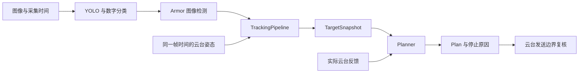

# 自瞄模块

当前链路识别联盟赛中的英雄、工程、步兵和哨兵装甲板，输出云台角度、角速度、角加速度和开火许可。前哨站、基地及非装甲目标会被过滤，能量机关不在本模块范围内。安装和运行命令见 [仓库 README](../../README.md)。

## 从入口读起

[auto_aim_sentry.cpp](../../task/auto_aim_sentry.cpp) 负责命令行、信号和一次配置加载；[AutoAimRuntime](../../task/auto_aim_runtime.hpp) 组织设备、推理、跟踪和控制线程。离线入口 [auto_aim_test.cpp](../../task/test/auto_aim_test.cpp) 调用同步的 `AimPipeline::step()`，按录包时间每帧运行一次完整链路。



| 位置 | 职责与主要入口 |
|---|---|
| `config.hpp/.cpp` | 一次解析、字段校验、单位转换和资源路径解析 |
| `armor.hpp` | 四角检测数据和只读 `SolvedObservation` |
| `yolo*`、`classifier` | 模型推理、角点解码和数字分类 |
| `detector` | 保留的传统灯条检测器，正式入口使用 YOLO |
| `solver` | 物理尺寸假设、歧义处理，公开只读解算入口 `resolve_observation()` |
| `armor_geometry` | PnP、安装模型拟合、投影、朝向优化和坐标转换 |
| `tracker`、`target` | 观测关联、确认/丢失状态机和整车 EKF |
| `planner` | 弹道拦截、参考轨迹、yaw/pitch 两轴 TinyMPC |
| `pipeline` | `TrackingPipeline` 共用解算和跟踪；`AimPipeline` 提供同步单步流程 |
| `multithread/mt_yolo` | 有界推理队列、帧时间与会话传递、停止和异常转交 |
| `aimer`、`shooter` | 保留的传统控制路径及其回归，正式 MPC 入口不调用它们 |

## 配置、坐标和单位

正式入口调用一次 `load_auto_aim_config(path)`，然后将 `CalibrationConfig`、`SolverConfig`、`YoloConfig`、`TrackerConfig`、`PlannerConfig` 等结构传给模块。路径构造函数仍可供单独调用使用；在新流程中应传已加载的配置，避免重复读文件。配置结构的构造入口也校验参数，不能通过绕开 TOML 解析传入非法值。

必需的标定数组和 MPC 代价数组会检查长度、类型和有限性，旋转矩阵检查正交性与行列式。已存在但不是表的配置段、把整数填进布尔字段等错误会被拒绝。配置错误消息包含字段名；可选字段缺失才使用默认值。

资源路径规则如下：未配置 `paths.base_dir` 时，相对路径以启动目录为基准；设置后，`base_dir` 自身相对 TOML 所在目录解析。相对模型和相机文件路径使用该资源目录，模型路径在加载后转为绝对路径。绝对路径及流 URL 不加资源目录前缀。

| 数据 | 约定 |
|---|---|
| 位置、长度、弹速 | 米、米、米/秒 |
| C++ 中的角度 | 弧度；角速度为 rad/s，角加速度为 rad/s² |
| 配置中的角度制字段 | `solver.max_balance_pitch`；`detector.max_angle_error/max_rectangular_error`；`planner` 和 `aimer` 的 yaw/pitch 偏移；`aimer.coming_angle/leaving_angle`；`shooter.first_tolerance/second_tolerance` |
| 已为弧度的配置 | `planner.fire_thresh`；不会再做角度转换 |
| 配置中的时间 | 延迟、目标有效期为秒；名称带 `_ms` 的反馈/重连时间为毫秒 |
| 时间戳 | `std::chrono::steady_clock::time_point`；实时用采集时钟，回放用录包秒数映射到同一类型 |
| 相机坐标系 | x 向右、y 向下、z 向前 |
| 云台与世界坐标系 | x 向前、y 向左、z 向上；世界系通过 IMU 对齐重力，以云台旋转中心为原点 |
| 旋转命名 | `R_camera2gimbal` 表示将相机坐标中的向量旋转到云台系 |

角度制字段统一按 `角度 × π / 180` 转换。相机内参、畸变和相机到云台外参必须对应同一次实际安装；这里的世界系不包含机器人全局平移定位。

## 检测和已解算观测

检测器输出 `Armor` 时，`points` 是固定长度 `std::array`，顺序为左上、右上、右下、左下；空间成员有初值，但 `pose_valid` 为假，不能作为位置量测使用。`Solver::resolve_observation(const Armor&, prior)` 返回 `optional<SolvedObservation>`，只在成功解算后提供只读装甲数据，原始检测不被修改。生产 `Tracker` 经这个边界获取空间观测。

`solve_observation(Armor&, prior)` 保留给已有调用方。`solve(Armor&)` 则是已知物理尺寸的底层几何接口，不执行尺寸歧义与最大残差筛选，不能直接代替跟踪入口的解算策略。

世界系位置和姿态是几何求解的基准结果。`ArmorGeometry::update_derived_pose()` 统一派生云台系位置、姿态和世界系球坐标，yaw 优化后也经过同一入口；失败重解算会清除 `pose_valid`。`yaw_raw` 保留优化前的朝向，供诊断使用。

模型的四个角点通道依次为左上、左下、右下、右上。解码器只按通道映射到 PnP 顺序，并检查有限性、凸性和面积，不按图像高低或边长重新排序；透视和侧倾会改变这些图像关系。替换模型时须保持该通道身份，或同时修改解码器和 `auto_aim.model_keypoint_contract` 回归。

YOLO 模型输入为 NCHW `1×3×480×640`，预处理接收 NHWC BGR `uint8`，输出须为 `float32 1×14×6300`。图像等比缩放后向右/下补黑。ROI 保存原始配置，每帧重新与图像边界求交；负宽高表示延伸到当前图像边缘。检测框和四角一起加回 ROI 偏移。

每个检测实例只由一个线程使用，复用 `InferRequest`、输入图像和 tensor；每帧清空补边，避免分辨率变化留下旧图。数字分类器复用自己的输入缓冲区，输出必须是九个有限的分数。传统检测器和 YOLO 共用数字区域裁剪规则。

## 尺寸判定的物理假设

1 号英雄使用大装甲，2 号工程和哨兵使用小装甲。3/4/5 号步兵在检测阶段标为 `unknown`，像素长宽比不能直接确定物理尺寸。几何模型使用 135 mm 和 230 mm 两种宽度，灯条端点间距为 56 mm。

尺寸判定分别拟合两个假设。平地小步兵装甲横边水平，安装俯仰为 15°；平衡步兵允许在 `solver.max_balance_pitch` 内俯仰，默认 ±60°。这些约束避免自由姿态的小装甲通过大幅倾斜并缩短距离，错误解释一块正面大装甲。`PoseRefinement` 和 `MountingModel` 枚举明确区分 PnP 初值、最小二乘细化与安装模型。

残差使用原图四个角点的 RMS 像素误差。超过 `max_reprojection_error` 的假设被拒绝；两个假设都落在 `size_noise_floor` 内，或误差差值小于 `min_type_error_gap` 时，新轨迹等待更明确的观测。默认噪声底为 1.5 px，需要结合实际角点误差调整。远距离、强侧视步兵可能在数字分类很有把握时仍无法初次确定尺寸。

已关联轨迹的尺寸可用来消除歧义，解算后仍须通过三维空间关联。明确支持另一尺寸的几何证据不会被先验覆盖。两种自由 PnP 都无法解释近水平横边时，或者允许小装甲 0–30° 俯仰和自由侧倾后也能解释角点时，不据此建立新的尺寸结论；已有轨迹可保持尺寸并使用自由 PnP，仍受残差和关联门限约束。

yaw 搜索围绕相机到目标的视线进行，并保留原始 PnP 候选，只有投影误差下降才替换朝向。IPPE 返回非有限值或非正深度时，使用相同角点对应关系重试迭代 PnP。本轮整理保留了原有拟合、噪声否决和朝向搜索策略，没有换用另一套物理模型。

## 跟踪快照和规划时间

`Target` 持有 EKF 和诊断历史，`TargetSnapshot` 只保存固定 11 维运动学状态、装甲数量、身份、观测标志和两个时间。状态索引由 `target_state` 命名：

```text
X, Vx, Y, Vy, Z, Vz, Yaw, YawRate, Radius, RadiusDifference, HeightDifference
```

其中 `RadiusDifference` 为交替装甲半径差，`HeightDifference` 为交替装甲高度差。普通目标使用四块装甲，平衡步兵使用两块。控制线程读取独立快照，不复制 EKF 协方差和统计历史，也不修改跟踪线程的状态。

`state_time` 表示状态已预测到的时间；`observation_time` 表示最后接受量测的时间。`Target::predict(dt)` 和 `predict(time)` 都推进状态时间，预测、空帧和拒绝的观测不会延长量测有效期。规划采样使用返回副本的 `TargetSnapshot::predicted()`，允许负偏移生成时域前段。时间加减检查非有限秒数和时钟溢出。

Planner 只有一个公开规划入口：

```cpp
Plan plan(const std::optional<TargetSnapshot>& target, double bullet_speed,
          TargetClock::time_point now,
          std::optional<io::GimbalState> feedback = std::nullopt);
```

`now` 在接口中默认当前单调时钟；离线调用必须显式传入录包时钟。它先检查快照、状态时间和最后观测时间，再补偿处理延迟并求弹道拦截。过期、未来时间、无可见装甲、弹道不可达、求解未收敛等情况返回零控制量及对应的 `StopReason`。旧的 `plan(Target, ...)` 调用应先生成 `target.snapshot()`，并传入本次规划的时钟。

每根轴独占一个 TinyMPC 求解器，销毁时释放资源；每帧两轴都会求解一次，以保留热启动和失败后的恢复行为。迭代预算为每轴 100 次，两轴都收敛且输出有限才允许控制。规划参考使用可见装甲的弹道拦截；相邻采样的参考速度基于同一块物理装甲，避免换板造成虚假的速度跳变。时域尾部允许用背向装甲保持数学轨迹连续，命令时刻和发弹采样仍须满足可见性要求。

无反馈时可生成控制计划，但 `fire=false`。有反馈时还检查接收时间、参考角度对齐、当前观测和规划误差；发送边界再次使用最新反馈检查实际输出。`Aimer/Shooter` 的旧路径保留独立回归，但不参与当前正式控制。

## 线程所有权和退出

| 执行位置 | 独占或维护的状态 | 交接方式 |
|---|---|---|
| 相机内部线程 | `VideoCapture`、最新图像和采集时间 | `USBCamera::read()` 返回图像与时间 |
| Runtime 采集线程 | 采集到的当前帧、对应会话号 | 移入推理输入队列 |
| YOLO 工作线程 | 模型、推理请求和输入缓冲区 | 输出检测、原始采集时间和会话号 |
| Runtime 跟踪线程 | `TrackingPipeline`、Solver、Tracker/EKF | 发布 `TargetSnapshot` 与会话号 |
| Runtime 控制线程 | Planner、MPC 热启动、周期统计 | 读取快照与云台反馈，发送命令 |
| 云台接收线程 | 反馈、姿态历史、模式与会话状态 | 受锁保护的完整快照及按帧时间查询的姿态 |

推理输入、输出队列容量均为 2，满时丢弃最旧消息。`ThreadSafeQueue` 支持关闭、停止令牌和移动所有权；关闭后拒写，已有消息可排空，阻塞消费者会被唤醒。满队列回调在锁外执行。`LatestValue` 用于控制线程需要的最新快照，读取既不阻塞等待新值，也不消费当前值。

Runtime 共用停止源组织自己的工作循环，信号处理函数只设置无锁原子标志。退出会停止相机读取、关闭推理队列，并取消等待姿态的操作；设备和推理对象回收各自内部线程。推理异常由 `push/pop/wait_pop` 转交到 Runtime，随后进入同一停止流程。

控制周期以单调时钟截止时间推进，名义步长为 10 ms。计算或发送超过期限时跳过已错过的周期，不连续补发旧控制。退出日志记录周期数、错过次数、最大计算耗时、实际发送间隔和目标年龄；这些统计用于现场诊断，不是实时性保证。

串口发送的背压等待不持有云台状态锁。每次实际写入前重新验证反馈、会话和命令有效期；已写出包前缀后若许可失效，不拼接另一份命令，而是撤销剩余发送并关闭该串口会话。Runtime 将 `valid_until` 设为最后观测时间加 `max_target_age`，避免等待串口后发送已经过期的控制。

## 回放与回归定位

`AimPipeline::step(frame, orientation, timestamp, bullet_speed, feedback)` 在单线程内依次执行检测、跟踪、规划，不读取墙上时间决定目标年龄。相同录包的处理次数与 MPC 热启动顺序因此固定。CSV 正常结束后替换目标文件；处理错误保留既有结果。完整命令、位姿文本格式和路径规则见 [README](../../README.md#离线回放与-csv)。

| 需要修改的行为 | 相关测试 |
|---|---|
| 标定、配置类型、角度和路径 | `auto_aim.config`、`auto_aim.calibration_validation` |
| 尺寸、强透视和侧倾 | `auto_aim.armor_type`、`auto_aim.perspective_keypoints`、`auto_aim.tilted_keypoints` |
| 优化后的坐标一致性 | `auto_aim.yaw_optimization` |
| 真实模型角点、ROI、分类到规划正例 | `auto_aim.model_keypoint_contract`、`auto_aim.vision_pipeline` |
| 预测/观测时间、快照和停控原因 | `auto_aim.prediction_time_contract`、`auto_aim.planner_time_contract`、`auto_aim.tracker_snapshot`、`auto_aim.planner_stop_reasons` |
| 推理线程和基础通道退出 | `auto_aim.worker_failure`、`auto_aim.worker_lifecycle`、`infra.channels`、`runtime.pose_wait_shutdown` |
| 重复回放、跳帧和错误录包 | `runtime.replay_deterministic`、`runtime.replay_positive_seek`、`runtime.replay_invalid_records` |
| 正式运行中丢目标后恢复 | `runtime.positive_target_recovery` |

上述回归使用合成几何、真实模型处理生成图像、伪终端和进程测试。它们没有覆盖本队实机相机标定、运动模糊、遮挡、命中率或设备上的端到端延迟；这些仍需实机录包和闭环测试。
